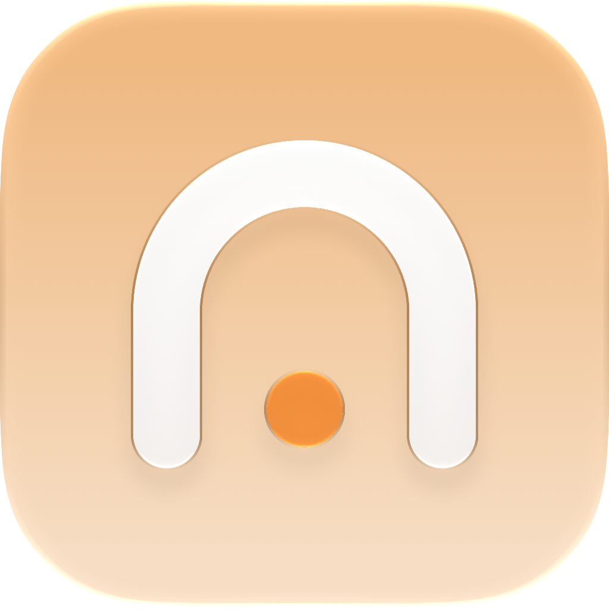

<p align="center">
  
</p>

# NSGo

**English** | [简体中文](README.zh-CN.md)

NSGo is a cross-platform native UI engine with a Go backend. App logic, the reactive graph and layout run in Go, and each platform draws with its own native UI.

NSGo follows the design of [Native Shell (NSH)](https://nsh.dev), which does the same in Rust. It exists for teams that want NSH's model without writing Rust.

## Status

NSGo is early. The engine has NSH's reactive model, block, flexbox and grid layout, lists, animated and vector images, canvas, SVG icons with the bundled Lucide pack, web views, videos, the app's own native views, animated values and layout animations, file drops, Markdown and HTML text views, overlays, dialogs, navigation and unstyled base components, running on macOS, iOS, Windows, Linux, the web and Android devices and x86_64 emulators. There is no release or stable API yet. [ARCHITECTURE.md](ARCHITECTURE.md#platforms) tracks each target.

## Goals

- Write apps and components in Go, with signals, memos and effects.
- Lay out with flexbox and grid, and render with each platform's own views and text.
- Target iOS, Android, macOS, Windows, Linux and the web, as NSH does.
- Embed NSGo in existing native apps, or package it as a standalone app.

## Usage

An app is a Go main package that calls `nsgo.Run`. Components are functions or types that return elements; signals update what reads them:

```go
package main

import (
	"fmt"

	"github.com/oneo-me/nsgo"
	"github.com/oneo-me/nsgo/base"
	"github.com/oneo-me/nsgo/core"
)

func Root(cx *core.Scope) core.Node {
	count := core.NewSignal(cx, 0)
	return core.View{Style: core.Style{Padding: core.All(24), Gap: 12}, Children: []core.Node{
		core.Text{ContentFunc: func() string { return fmt.Sprintf("Pressed %d times", count.Get()) }},
		base.Button{
			Label:    "Press me",
			OnPress:  func(core.PressEvent) { count.Update(func(n int) int { return n + 1 }) },
			Style:    core.Style{Padding: core.Symmetric(6, 14), CornerRadius: 8, Background: core.RGB(0xbd481b), Color: core.RGB(0xffffff)},
			Children: []core.Node{core.Text{Content: "Press me"}},
		},
	}}
}

func main() { nsgo.Run(Root) }
```

Test it headless with `nsgotest`, no window needed:

```go
func TestPress(t *testing.T) {
	app := nsgotest.Start(t, Root)
	app.Press("text:Press me")
	app.Find("text:Pressed 1 times")
}
```

Beside the package, `nsgo.yaml` names the app and its targets:

```yaml
name: Hello
id: dev.oneo.nsgo.hello
version: 0.1.0
window: { width: 420, height: 560 }
icon:
  apple: assets/AppIcon.icon  # macOS and iOS; macOS also takes an .icns
  png: assets/Icon.png        # every other target, and Apple ones without the above
dev:
  target: native        # native, web, ios (a connected iPhone), ios_simulator or android (a device or emulator)
  hot_reload: false     # run once and exit with the app; true rebuilds and restarts on save
build:
  output: dist          # packages go to dist/<name>-<version>-<target>
  open: false           # true opens the output directory after building
  targets: [macos_arm64, macos_x64, windows_arm64, windows_x64, linux_arm64, linux_x64, ios, ios_simulator, android_arm64, android_x64, web]
```

Two directories sit beside `nsgo.yaml`. `resources/` holds files the app ships: each package puts them in its resource root, where `asset:` images load from. That root is `Contents/Resources` on macOS, the bundle on iOS, the APK's assets on Android and `resources/` beside the executable or page elsewhere. `assets/` holds project files that do not ship, such as the icons `icon` defaults to.

Add the tool to your module once; `go tool nsgo` then runs it without installing:

```sh
go get -tool github.com/oneo-me/nsgo/cmd/nsgo
```

`go tool nsgo dev` runs the app once and exits when the app does. Set `dev.hot_reload` to `true` to rebuild and restart it when a source file changes. Its builds show the app's icon with a DEV badge; to show other files, name them in `dev.icon`, which takes `apple` and `png` as `icon` does, or put `AppIcon-dev.icon`, `AppIcon-dev.icns` or `Icon-dev.png` in `assets/`. `go tool nsgo build` writes a stripped release package per target; set `build.open` to `true` to open the output directory when it finishes. `build.targets` and `-target` accept `all` for every platform that needs only Go and Xcode; add `android_x64` when an NDK is installed.

Both commands' flags replace the `nsgo.yaml` values they name: `-name`, `-id`, `-version`, `-width` and `-height` on both, `-target` and `-hot-reload` on `dev`, and `-target`, `-output` and `-open` on `build`. `dev` also takes `-fps` to show the performance monitor on macOS, `-device` to choose an iPhone and `-team` to choose the Apple developer team. `-h` lists every flag.

## Development

Requirements: macOS with Xcode and Go 1.25 or later. Nothing else is needed to build every target for arm64, Android's APK included.

Android device and emulator development additionally needs `adb` from the Android SDK's platform-tools, and iOS device development needs an Apple ID in Xcode's Accounts, a trusted iPhone and Developer Mode on it.

The x86_64 emulator target, `android_x64`, also needs an Android NDK: Go links android/amd64 only with cgo. On Windows, Go 1.25 or later runs the native app and builds the Windows and web packages. On Linux, Go runs the native app once GTK 4.14 or newer, Pango and Cairo are installed, WebKitGTK 6.0 for web views and GStreamer plug-ins for videos.

Run the gallery from the repository root; it shows every element, `base` component and service in a standard window.

```sh
go tool nsgo dev examples/gallery                   # nsgo.yaml's dev target, exiting with the app
go tool nsgo dev -fps examples/gallery              # with the performance monitor (macOS)
go tool nsgo dev -target web examples/gallery       # in the browser, serving until interrupted
go tool nsgo dev -target ios_simulator examples/gallery
go tool nsgo dev -target ios examples/gallery       # on the connected iPhone, signed by Xcode
go tool nsgo dev -target android examples/gallery   # on the connected device or emulator, over adb
go tool nsgo build examples/gallery                 # release packages in examples/gallery/dist
go tool nsgo build -target all examples/gallery     # every platform's release packages
go test ./...
bench/run.sh                                       # measure the quotes benchmark (bench/README.md)
```

Run `go test ./internal/platform/windows` on Windows or `go test ./internal/platform/linux` on Linux to open a real window and check input and painting; they skip where no desktop is available.

NSGo uses NSH as its reference implementation. Clone it into `nsh/` at the repository root; Git ignores that directory:

```sh
git clone https://github.com/longbridge/nsh.git nsh
```

Read [ARCHITECTURE.md](ARCHITECTURE.md) and [AGENTS.md](AGENTS.md) before changing code.

The website is the gallery compiled to the web at <https://oneo-me.github.io/nsgo/>. Run it with `go tool nsgo dev -target web examples/gallery`; the [Website workflow](.github/workflows/website.yml) publishes it to GitHub Pages.

## License

Licensed under the [Apache License, Version 2.0](LICENSE). NSGo is a port of NSH, and [NOTICE](NOTICE) records the attribution that port owes.

Unless you explicitly state otherwise, any contribution intentionally submitted for inclusion in NSGo by you, as defined in the Apache-2.0 license, shall be licensed under Apache-2.0, without any additional terms or conditions.

## Author

[Blog](https://oneo.me) · [X @oneo666](https://x.com/oneo666)
