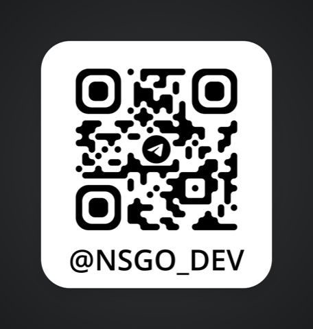

<p align="center">
  
</p>

<h1 align="center">NSGo</h1>

<p align="center">
  <strong>简体中文</strong> |
  <a href="README.md">English</a>
</p>

<p align="center">
  <a href="https://github.com/nsgo-dev/nsgo/releases/latest"></a>
  <a href="https://pkg.go.dev/github.com/nsgo-dev/nsgo"></a>
  <a href="LICENSE"></a>
</p>

<p align="center">
  <a href="https://github.com/oneo-me"></a>
  <a href="https://oneo.me"></a>
  <a href="https://x.com/oneo666"></a>
  <a href="https://t.me/nsgo_dev"></a>
  <a href="https://github.com/sponsors/oneo-me"></a>
</p>

<p align="center">
  以 Go 为后端的跨平台原生 UI 引擎：应用逻辑、响应式图和布局在 Go 中运行，各平台使用自己的原生 UI 绘制。<br>
  它参考 <a href="https://nsh.dev">Native Shell（NSH）</a> 的设计，面向想要 NSH 的模型、但不想写 Rust 的团队。
</p>

<p align="center">
  <picture>
    <source media="(prefers-color-scheme: dark)" srcset="website/src/assets/screens/desktop-zh-dark.jpg">
    
  </picture>
  <picture>
    <source media="(prefers-color-scheme: dark)" srcset="website/src/assets/screens/phone-zh-dark.jpg">
    
  </picture>
</p>

## 亮点

- **原生视图。** 文字、输入法、滚动、菜单和无障碍都使用各平台自己的实现；某个平台独有的效果（例如 Liquid Glass），其他平台会模仿。
- **一台 Mac 构建所有平台。** Go 构建所有目标，iOS、tvOS 和 watchOS 另需 Xcode，只有 x86_64 Android 模拟器需要 NDK：不需要 Android SDK、JDK、GTK 或 Windows 工具链。
- **细粒度更新。** 组件只运行一次，signal 只更新读取它的部分；支持 flexbox 与 grid 布局、类 CSS 样式、Tailwind 类名、主题，动画跟随平台的帧时钟。
- **组件。** `base` 提供无样式组件，从按钮到百万行的 `DataTable`、图表、流程图、代码编辑器、富文本编辑器和终端；`ui` 为它们加上 NSGo 的外观。
- **平台服务。** 导航、通知、权限、选择器、分享、触感反馈、应用内购买、小组件和实时活动；桌面上还有窗口、面板、菜单、托盘图标和全局快捷键。
- **本地化。** YAML 消息目录，支持 CLDR 复数规则、数字和日期格式，以及从右到左布局。
- **TSX 应用。** 像 NSH 一样用 TSX 写应用，热更新保留状态，并打包成由 Go 应用运行的、签名且沙盒化的包。
- **像用户一样操作的测试。** `nsgotest` 点按、输入并读取屏幕上的内容，可无界面运行，也可在各平台上以原生输入运行并截图。
- **`nsgo` 工具。** 创建应用，以热重载和 DevTools 运行，并打包发布到应用商店、Flathub，或带自动更新的直接下载。
- **小而快。** 一个计数器应用在桌面上打包后约 8 MB，在 NSGo 的基准测试中启动比 NSH、MyGo 和 GPUI 更快。

## 平台

| 平台 | 绘制方式 | 状态 |
| --- | --- | --- |
| macOS | AppKit 和 Core Text | 可用 |
| iOS 及轻 App（App Clip） | UIKit 和 Core Text | 可在模拟器和真机上运行；轻 App 在模拟器上运行 |
| tvOS | UIKit，由遥控器移动焦点 | 可在模拟器上运行 |
| watchOS | SwiftUI 和 Core Graphics | 可在模拟器上运行 |
| Android | Android View | 可在 arm64 真机和 x86_64 模拟器上运行 |
| Windows | Direct2D 和 DirectWrite | 可用 |
| Linux | GTK 4、Pango 和 Cairo | 可用 |
| Web | 由 WebAssembly 驱动的 DOM 元素 | 可用 |
| 鸿蒙 | ArkUI | 预览 |
| 微信、QQ、支付宝和抖音小程序 | 各平台自己的视图 | 试验性，受小程序 2 MB 包体限制 |

应用也可嵌入独立的 iOS、Android、Go 桌面和 Web 应用。各目标如何对接系统见 [ARCHITECTURE.md](ARCHITECTURE.md#platforms)。

## 快速开始

安装 [Go](https://go.dev/dl/) 1.27.3 或更新版本（构建 iOS、tvOS 和 watchOS 还需 Xcode）和 `nsgo`（[其他安装方式](docs/public/zh/getting-started.md#安装-nsgo)）后，创建应用并以热重载方式运行：

```sh
brew install nsgo-dev/tap/nsgo
nsgo init -module example.com/hello hello   # 加 -template tsx 创建 TSX 应用
cd hello
nsgo dev    # 加 -target web、ios_simulator、tvos_simulator、watchos_simulator、android 或 miniprogram_wechat 在别处运行
nsgo doctor # 列出本机能构建、运行哪些目标，以及其余目标缺什么
```

应用由返回元素的 Go 组件构成，signal 变化时只更新读取它的部分：

```go
package main

import (
	"fmt"

	"github.com/nsgo-dev/nsgo"
	"github.com/nsgo-dev/nsgo/core"
	"github.com/nsgo-dev/nsgo/ui"
)

func Root(cx *core.Scope) core.Node {
	count := core.NewSignal(cx, 0)
	return core.View{Style: core.Style{Padding: core.All(24), Gap: 12}, Children: []core.Node{
		core.Text{ContentFunc: func() string { return fmt.Sprintf("Pressed %d times", count.Get()) }},
		ui.Button{Text: "Press me", OnPress: func() { count.Update(func(n int) int { return n + 1 }) }},
	}}
}

func main() { nsgo.Run(Root) }
```

测试像用户一样操作应用，`nsgo test` 可无界面运行它们，加 `-target` 则在指定平台上运行：

```go
func TestPress(t *testing.T) {
	app := nsgotest.Start(t, Root)
	app.Press("role:button Press me")
	app.Find("text:Pressed 1 times")
}
```

想在发布前试用 `main` 上的最新代码，运行 `go get github.com/nsgo-dev/nsgo@main`。

## 状态

NSGo 处于早期阶段，API 尚未稳定。每个版本的变更见 [Releases](https://github.com/nsgo-dev/nsgo/releases)，仍缺少的部分见[路线图](docs/roadmap.md)。

## 文档

[文档](https://nsgo.dev/zh/docs/)介绍组件与状态、布局、样式、导航、组件参考、TSX 应用、本地化、测试、嵌入以及构建与发布；[在线体验](https://nsgo.dev/gallery/)可在浏览器中运行 gallery。

编程智能体可以通过 NSGo 的技能学习它（`bunx skills add nsgo-dev/nsgo`），并从 [llms.txt](https://nsgo.dev/llms.txt) 以 Markdown 阅读文档。

## 开发

```sh
go tool nsgo dev examples/gallery   # 运行 gallery
go tool nsgo check                  # 检查所有包
go tool nsgo test                   # 运行所有包的测试
```

其余的开发环境配置见[参与开发](https://nsgo.dev/zh/docs/contributing/)。修改代码前请先阅读 [ARCHITECTURE.md](ARCHITECTURE.md) 和 [AGENTS.md](AGENTS.md)，上次发布以来的变更见 [CHANGELOG.md](CHANGELOG.md)。

## 社区

欢迎到 Telegram 群组 nsgo-dev-community（[@nsgo_dev](https://t.me/nsgo_dev)）提问、交流想法，或分享你用 NSGo 做的东西。Bug 和改动建议请提到 [issues](https://github.com/nsgo-dev/nsgo/issues)。

<p align="center">
  <a href="https://t.me/nsgo_dev"></a>
</p>

## 赞助

[Depot](https://depot.dev) 赞助了 NSGo 的 CI：它的 runner 在 Linux、macOS 和 Windows 上构建并测试 NSGo。

<p align="center">
  <a href="https://depot.dev"><picture>
    <source media="(prefers-color-scheme: dark)" srcset="website/src/assets/sponsors/depot-dark.svg">
    
  </picture></a>
</p>

## 许可证

本项目以 [Apache License 2.0](LICENSE) 授权。NSGo 是 NSH 的移植，[NOTICE](NOTICE) 记录了移植所需的署名。

除非你明确声明，否则你提交给 NSGo 的任何贡献，按 Apache-2.0 许可证的定义，均以 Apache-2.0 授权，不附加任何额外条款或条件。
