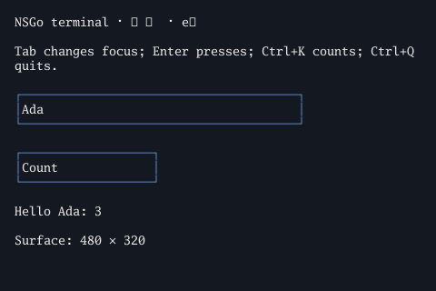

# Terminal

`base/terminal` is a terminal for NSGo apps: a `View` that runs the user's shell, or any program, in a pseudo-terminal, with Ghostty's emulator, libghostty-vt, loaded at run time through purego on native targets or instantiated as WebAssembly in a browser. NSH's `term` module draws a replaceable emulator as native text rows; NSGo uses Ghostty's state and a canvas, with Ghostty as the reference for behavior and names. Read this before changing the package.

## Packages

| Package | What |
| --- | --- |
| `base/terminal` | `Terminal` (the emulator, the program and their goroutines), `View`, themes with Ghostty's, keys |
| `base/terminal/locales` | The lines the terminal writes when its program ends, in the language the view's app shows |
| `base/terminal/internal/vt` | The binding of libghostty-vt's C API: validated native layouts or marshaling across browser guest memory |
| `base/terminal/internal/pty` | Pseudo-terminals in pure Go: `/dev/ptmx` on macOS and Linux, ConPTY on Windows |
| `tsx/terminal` | `Terminal` in TSX's `nsgo/base`: the view over a session its props start ([TSX](tsx.md#go-components)) |
| `base/terminal/internal/library` | Provides the embedded browser module, or finds a native library: `$NSGO_GHOSTTY_VT`; the one the nsgo tool put into the app, an iOS app's `GhosttyVT.framework` or a macOS app's `Frameworks`, or one beside the executable; else on desktops the build it embeds for the platform, written once into `<cache>/nsgo/libghostty-vt/<sha256>/` |

It is a package under `base` because it links what an app without it should not, and the one there that is not portable: it reaches native libghostty-vt through purego, the browser's guest through `syscall/js`, and programs through `syscall` ([package layers](layers.md)). Desktops run local programs and remote sessions; iOS, Android and the browser run remote sessions only (`Options.Conn`), and `New` without one returns an error there. Mini programs and HarmonyOS still return an unsupported error ([roadmap](../roadmap.md#terminal)). It imports `core` and `i18n`. Its only look is the terminal's palette, as `Editor`'s is its highlighting's: `Theme` and `DarkTheme`, Visual Studio Code's colors when unset; the app styles the view around the grid.

## The library

libghostty-vt is built from Ghostty's sources at the commit the binding names, by `go run ./tools/libghostty` on a Mac with Xcode: it clones Ghostty into the user's cache, downloads the Zig its `build.zig.zon` asks for from ziglang.org, checked against the index's SHA-256, and builds every desktop target, iOS devices, both simulator architectures and Mac Catalyst, and the browser module, stripping the Linux builds' debug sections. The builds are committed in `internal/library/lib/`, as users have no Zig ([principles](../../AGENTS.md#principles)), so nothing is downloaded at run time. A desktop's is embedded in the apps that link the terminal, so `go run` and `go test` find it; the nsgo tool also signs it into macOS apps, where hardened apps load only signed libraries, and into iOS apps as a framework, the only way iOS loads native code ([tool](tool.md#packages)). Windows and Linux packages put the library beside their executable; iOS `-embed` writes a companion `GhosttyVT.xcframework` with all app slices, which hosts embed and sign for static and dynamic apps alike. An arm64 AAR carries the Android library supplied by #1452 in its JNI ABI directory. `-target` selects comma-separated library storage keys, such as `iossimulator-amd64,ioscatalyst-arm64`, or `all` (the default). The command also writes `ghostty_themes.go`, the themes Ghostty ships; `-themes` writes them alone.

The library runs on macOS 13 or later, Linux with glibc 2.28 or later (Debian 10, Ubuntu 20.04) and Windows 10 1809 or later, whose ConPTY runs the program.

## Browser binding

The browser embeds `internal/library/lib/js-wasm/ghostty-vt.wasm`; `LibraryPath` is its embedded identity, not a file. `tools/libghostty -target js-wasm` builds the pinned source as `wasm32-freestanding` with `ReleaseSmall`, archiving it into a temporary tree before enabling its graphics feature and refusing file-based image media. The source checkout and every native target stay unchanged. Shared-memory media already refuse freestanding targets; inline RGB/RGBA/PNG images retain the Go decoder. The generator writes the linked Ghostty, Zig and Wuffs notices into `internal/library/LICENSE`.

- The Go and guest modules own separate memories and have different pointer widths. Each export has an explicit argument schema; structs marshal by the guest manifest and the generated 64-bit `internal/vt/abi64.json`, checked against Go's mirrored structs. Guest pointers never address Go memory. Rebuild that manifest with `go tool nsgo test -run TestWriteWasmHostABI -env NSGO_GHOSTTY_ABI_OUT=<absolute-output> ./base/terminal/internal/vt` on a native target after changing the pin.
- Every foreign memory access reacquires the guest buffer after allocations can grow it. Opaque handles stay guest values; host input buffers copy in, outputs copy back, and key-event UTF-8 remains allocated until the event releases it.
- Typed Wasm trampolines occupy the exported indirect-function table for callbacks. The C API's secure-random effect uses Go's browser cryptographic source, so clipboard paste grants have real entropy without OS services.
- Long export bursts yield outside guest callbacks so Go's finalizers can release JavaScript references; cached exports and constructors limit handle churn. The 3,000-frame randomized mirror test exercises that path.

The app adapts its WebSocket to `io.ReadWriteCloser`, joining and splitting binary messages as a byte stream; NSGo defines no server/control protocol. A connection's existing optional resize methods carry the app's own protocol. `cmd/nsgo/TestTerminalBrowserSession` drives a real browser against a native PTY over a real WebSocket, checking typed command output, ANSI pixels, alternate-screen restoration and close. Other JavaScript hosts stay unsupported until their module-loading and input paths are verified.

## Terminal

`Terminal` takes `Command`, `Dir`, `Env`, `Conn`, `Scrollback`, `Cursor` (which `SetCursor` changes in a running terminal), `CursorBlink` and the `OnTitle`, `OnExit` and `OnBell` callbacks. A reader goroutine writes the program's output into the emulator under the terminal's lock; a queue writes input on a goroutine of its own, so a program that reads nothing never blocks the reader answering its queries. The program starts at the first size a view gives, or at 80×24 after half a second. Its end writes a line of `locales` in the language the view last drew in.

A terminal no view shows, as a server's for a session, sizes with `Resize` and `ResizePixels` and has `Mirror`s (`mirror.go`): `Frame` returns the VT sequences that bring another terminal, one whose `Conn` reads the frames with `ResizeByConn`, to what this one shows, cell for cell, with its cursor, modes and scrollback. `ClearScreen` clears above the prompt, and programs' OSC 52 writes go on through the frames.

`Close` closes `Conn` or ends the local program. On macOS and Linux it hangs up the terminal and every process group of its session, the program's and those of the jobs an interactive shell started, then sends them SIGTERM after 250 ms and SIGKILL after another 250 ms, so programs inheriting an ignored SIGHUP still exit; a program that wants to outlive the terminal starts a session of its own (`setsid`). Shutdown runs off the caller's goroutine; `Done` waits for it. The PTY keeps the leader's PID, which is also the session's ID, reserved until its last signal, even if the leader exits before its children, so escalation cannot signal a reused PID. Windows closes ConPTY, which ends its attached processes. The app owns the terminal's lifetime and calls `Close` in its view's cleanup when they should end together.

`Search` finds text in the screen and the scrollback, a slice of the search each frame, reports through `OnSearch` and marks the matches the viewport shows. `SearchNext` selects older matches and `SearchPrevious` newer ones; `EndSearch` removes the highlights. The configured search background and foreground colors paint before glyphs and the cursor. Search-driven viewport changes precede the render snapshot, and synchronized output holds its highlights with its text.

## View

- The screen is a `core.Canvas`. Unicode box drawing and blocks and Powerline U+E0B0–U+E0B7 use grid-sized canvas shapes with shared pixel edges (`graphics.go`); other text uses platform fonts. `MinimumContrast` adjusts ordinary text against resolved cell backgrounds, including selection and faint alpha, while graphics and emoji keep their colors. `PaddingColor` selects the background or nearest-cell extension, with primary-screen prompt/default-background/Powerline heuristics unless `PaddingExtendAlways`.
- Cursor blinking follows the emulator's state. A native animated alpha slot changes only the cursor; its preceding screen drawing stays cached, with no per-frame engine work. Focus loss, composition and reduced motion leave it steady. The existing steady default remains (`Options.CursorBlink` opts in), unlike Ghostty's blinking default, preserving NSGo's mirror default-cursor behavior.
- Each drawing updates libghostty-vt's render state and records the rows: background spans, the selection, then text, ASCII in runs of one style and anything else in its own cells, so a fallback font's width moves nothing after it; decorations; the cursor, hollow without the focus. The terminal's reader asks for a frame by bumping a signal through `Scope.Post`, once until the frame comes.
- Cells are the font's advance of `M` wide and its line height tall, in points; the screen is told their size in pixels by the pixel ratio. A program's synchronized update (mode 2026) holds the render state until it ends, or a second.
- A vertical `Scroll` over the canvas is the hit layer, as `DataTable`'s: its content is as tall as the viewport and the scrollback, and its offset moves the terminal's viewport a row at a time; output moves it to another row with `Ref.ScrollTo`, sizing it from the same read of the terminal so the platform never clamps the row, and ignores that scroll's own report and the stale ones from before it (`ScrollEvent.Stale`); a report at the content's end follows the output again, and it stays put on the viewport's row, as moving it would stop a gesture and its momentum. The wheel, the touchpad and the scroll bar are then the platform's. Its content's `OnPressDown`, `OnMouseMove` and `OnPressUp` drive libghostty-vt's selection gesture.
- `mouse.go` keeps that content as one `core.Element`, changing its wheel subscription only when the program's modes require reports or alternate-screen cursor keys. Raw mouse buttons and motion use `vt.MouseEncoder`, cell protocols map fractional font advances to integer cell centers, and SGR-pixel mode uses rendered pixels. Shift keeps selection available; `MouseReporting` can disable capture reactively. Wheel fractions accumulate with Ghostty's precision/discrete defaults of 1/3; primary scrollback remains native. `MouseEncoder.Sync` refreshes modes after output, explicit mode changes or reset, and geometry only when changed: both C API setters clear motion deduplication. A mode generation preserves last-selected format ordering even when enabled flags stay set. macOS releases use the down event's mask bit; Windows, Linux and the browser already dispatch their unmasked release events directly.
- An invisible `Input`, the sink, sits at the cursor as `Editor`'s does, so input methods compose there: `core` has no raw key events. Its changes become backspaces and typed text, a character sent as its key so the Kitty keyboard protocol sees it, and its pastes `Terminal.Paste`, bracketed as the program asks. While it has the focus, the view binds with `KeyAlways` the keys that type no text, with every combination of Shift, Control and Alt, Control with each character key and, but on Apple platforms where Option types characters, Alt with them, and encodes them with libghostty-vt's key encoder, which follows the program's modes.
- Links are programs' hyperlinks (OSC 8) and URLs printed as text, found as Ghostty's `link-url` does in the line under the mouse, through the rows it soft-wraps over, each time the mouse changes cell, a modifier key changes or a frame draws, so output moves nothing from under it (`link.go`). A link underlines faintly as the mouse hovers and fully with a hand while Command, or Control off Apple platforms, is held, when a click opens it with `Scope.OpenURL` instead of selecting; a press released off the link opens nothing. Existing local paths and local `file:` hyperlinks open through `Scope.OpenFile`; relative paths use the shell’s OSC 7 directory, falling back to `Options.Dir` (or home) for local programs that have not reported one. Quoted paths keep spaces; diagnostic `:line:column` suffixes are outside the link. Paths in remote OSC 7 authorities and a `Conn` without a local directory report are not mapped onto local files. This adds filesystem existence checks to Ghostty’s regex model so ordinary output and missing files stay unlinked; `OpenURL` keeps its scheme policy, and `Host.HandleOpenURL` still sees URLs only.
- Clipboard protocols are the mounted view’s authority (`clipboard.go`): `AllowClipboardRead` and `AllowClipboardWrite` are false by default, unlike Ghostty’s ask/allow defaults, because apps own consent UI. TSX’s permission props are reactive without restarting the session. Program requests also check that view’s `AccessClipboard`; native services run on its scope, outside the parser lock. Reads defer until the engine answers and are refused on disposal, replacement or close. Explicit user paste offers a copied text/PNG snapshot in Kitty mode 5522, with the library’s one-use password; that token serves only the offered data, even if the system clipboard changes. Ordinary paste stays bracketed text. Input paste events retain their supplied text/PNG; native image services normalize other supported encodings. X11’s primary selection is refused, and Mirror forwarding is unchanged.
- The font, the themes and the padding are the view's props, so changing them builds the view again while the terminal and its program go on.
- `Keybinds` register after the focused, noncomposing input's defaults, so later actions override them. `actions.go` owns the session-independent subset of Ghostty actions: clipboard, selection, clear, font size and ignore; window and tab actions remain the app's. A view's tracked point size drives its grid and input font in place, with Ghostty's 1–255 point bounds and reset to the configured size. A secondary click opens an unstyled `base.ContextMenu` with the package's localized Copy, Paste, Select All and Clear items; `RightClickAction` can copy, paste, choose by selection or leave the event to the app. [Terminal actions](../public/en/terminal.md) documents the API.

## Images and shell integration

`Options.ImageLimit` enables Kitty graphics storage, 64 MiB by default and disabled when negative, on every target that runs the terminal. The smaller default than Ghostty's 320 MiB accounts for the view and core's copies of visible pixels. Programs send RGB, RGBA or PNG images; the pinned library handles transmission, replacement, deletion, scrolling, source cropping and normal relative placements. The view caches premultiplied canvas images by image ID and generation, drops offscreen sources, and snapshots them with text so synchronized updates freeze both.

The view clips image placements to the grid. Z below `-1<<30` paints before nondefault cell backgrounds, other negative Z between backgrounds and text, and nonnegative Z above text but below the cursor and IME. Ties paint in image ID and then placement ID order. Natural sizes and offsets are physical pixels; explicit cell sizes use the view's fractional grid, preserving aspect ratio when only one dimension is requested. Unicode placeholders (`U+10EEEE`) resolve image/placement IDs from raw colors and coordinates from Kitty's diacritics, inherit omitted adjacent coordinates, and fit their virtual grid with centered aspect preservation. Relative placements rooted in virtual placements remain a goal because the pinned placement API does not resolve their viewport positions.

An Alt/Option-only click in the active OSC 133 command input sends ordinary left/right cursor keys, encoded in the program's modes. The semantic-prompt callback enables it only between input-start (`B`) and output, command-end or prompt-start markers; the row-based cursor-at-prompt flag alone also covers output on a prompt row. Clicks count editable graphemes across soft wraps, normalize wide spacers and clamp to the input's ends. Scrollback, the alternate screen, unmarked output, drags, releases outside the viewport and output that ends input between press and release send no movement. Shells supply their own OSC 133 integration; NSGo injects no shell scripts.

## Touch screens

Where `Env.Desktop` is false:

- A finger scrolls the scroll layer, as any scroll view; a tap gives the sink the focus, which shows the software keyboard, and a long press selects the word under the finger, as a double click does. The press's delay is 200 ms: with the 150 ms a scroll view holds its content's touches back, the word is selected before a context menu's hold of 400 ms opens it. Both of the view's scroll views keep the keyboard through taps (`KeyboardTapsAlways`), or a press on the bar would dismiss it and take the bar away before the press ended.
- A software keyboard's Return and Backspace reach no key binding: Return submits the sink, which keeps the focus and sends Enter, and Backspace is reported only in an empty sink, which sends it; elsewhere it shortens the sink's text.
- The sink's text is what was sent plus what is being composed. An input method's commit is reported before its composition ends, whose end sends how the text differs from what was sent, and nothing else goes while it composes: the keys are unbound then, for the input method, and the frame draws the composition underlined at the cursor, as the sink shows nothing.
- `Ref` copies, pastes, selects all and reports a selection as a signal. The view's default `base.ContextMenu` opens as a sheet after a long press and at the pointer on desktops; apps supplying their own menu set `RightClickIgnore` and call the same ref actions.
- A bar of the keys software keyboards lack (`DefaultKeyBar`: Escape, Tab, Control, Alt, the arrows and `|~/-`) shows under the grid while the sink has the focus, in a horizontal `Scroll`, styled by the app's `KeyBar*` and `Key*` parts. Its keys take no focus. Control and Alt latch for the next key, from the bar or typed, which takes them; their caps and labels are the package's catalogs'.
- The grid and the bar keep above the keyboard: the view's frame in the surface, its window's height and `Env.KeyboardHeight` give how far the keyboard covers its bottom, which an inner box leaves free, so the terminal has the rows above it.

The gallery's Terminal demo (`examples/gallery/terminal.go`) sets each option beside the view, under its API's name, and shows what the shell reports. What the terminal does not do yet is in the [roadmap](../roadmap.md#terminal).

## Backend

`internal/platform/tui` runs an application in the terminal itself, selected by `nsgotui`. It implements the same engine and mount protocol as the GUI backends. `base/terminal` remains the embedded terminal component above; it does not implement this backend.

The terminal owns its dimensions. Each cell represents 8 by 16 layout points, regardless of its font; the text engine uses grapheme boundaries and display widths for wrapping, UTF-16 carets and selection geometry. Styles can set cell backgrounds, solid borders and text attributes. Frames, clipping, scroll offsets and static transforms share geometry with hit testing. Application text is sanitized before reaching tcell, so control characters cannot inject terminal commands. A text layout is immutable and needs no native resources when released.

The application loop drains mount batches and input on one goroutine. It requests engine frames without blocking the engine, and restores the alternate screen, cursor and terminal modes on normal exit, interrupts and errors. Terminal Control is `mod`, including on a Mac, since the terminal application normally takes Command itself. Tab and Shift+Tab traverse controls; bindings precede editor actions and focused button activation. Bracketed paste inserts text into the focused editor without executing pasted shortcuts. Legacy keyboard protocols supply no key releases, so each press is reported as a down/up pair; advanced protocols retain their releases.

`nsgo dev -target tui` builds a host console binary. While it runs, tool and application diagnostics append to `.nsgo/tui.log`, keeping output out of the cell display. The `tui` build/check group expands to `tui_macos_arm64`, `tui_macos_x64`, `tui_windows_arm64`, `tui_windows_x64`, `tui_linux_arm64` and `tui_linux_x64`. They use Go alone, without GTK or a Windows GUI subsystem. `nsgo test -target tui` requires a live terminal, a linked backend and `nsgotest.Main`; each test owns one application. Its steps use the same editor, pointer, key conversion and renderer as Run. PNG captures rasterize the cells with a fixed portable face rather than the emulator's font.

NSH's `docs/dev/tui.md` and `nsh-platform-tui` module docs informed the fixed grid and host loop. NSGo deliberately keeps component forms and sizes explicit: no core/base component switches its presentation for the terminal. The application in `examples/tui` chooses its own cell-sized styles.

This first backend draws views and text, edits fields and scrolls content. Canvas, images, media, native hosted components, system alerts and menus, layout animations, scroll snapping/inertia, modal focus trapping, zoom, bidirectional shaping, head/middle ellipsis and a system clipboard bridge remain goals. The clipboard is process-local; terminal bracketed paste still accepts text from the user's terminal. Use application views for terminal dialogs and menus, and text assertions for characters the portable PNG face does not contain. Windows console execution still needs native acceptance beyond cross-compilation.
